# Pulse – Django Discussion Platform


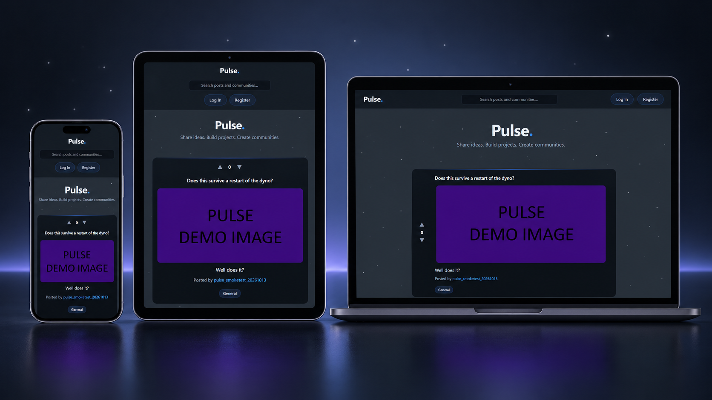

---

## ⚠️ Important Note

The first commit for this project is considerably larger than would typically be expected.
During the early stages of development, a widely reported Remote Code Execution (RCE) vulnerability affecting a tool within the development ecosystem was disclosed. As a precautionary measure, commits and asset uploads were temporarily delayed until the situation stabilised and it was considered safe to resume normal repository activity.
Development of the project itself continued during this time; however, changes were intentionally withheld from the repository to avoid committing work during a period of uncertainty.
As a result, the initial commit contains a substantial portion of the project that would normally have been distributed across multiple incremental commits.
This approach was taken to maintain a security-conscious and responsible development workflow.

---

## Table of Contents

- [Overview](#overview)
- [Purpose](#purpose)
- [Features](#features)
- [Built With](#built-with)
- [Project Structure](#project-structure)
- [Database Schema](#database-schema)
- [Viewing the Site Locally](#viewing-the-site-locally)
- [Deployment](#deployment)
- [User Features](#user-features)
- [User Stories](#user-stories)
- [User Story Mapping](#user-story-mapping)
- [User Story Validation (Screenshots)](#user-story-validation-screenshots)
- [Wireframes](#wireframes)
- [Testing](#testing)
- [Assessment Remediation](#assessment-remediation)
- [Security](#security)
- [Development Challenges](#development-challenges)
- [Lessons Learned](#lessons-learned)
- [Future Improvements](#future-improvements)
- [Credits](#credits)

---

## Overview

Pulse is a Reddit-style discussion platform built using Django.

It allows users to create posts, comment on content, and interact within a structured community environment.

The project focuses on backend architecture, authentication systems, and full CRUD-based interaction between users and content.

---

## Purpose

Pulse is a community discussion platform designed for users who want a focused place to share ideas, create posts and take part in conversations around topics that interest them. It provides a structured alternative to fragmented social-media discussion by bringing posts, comments, voting, search and user profiles together within one consistent application.

The platform is intended to support ongoing participation rather than one-off content consumption. Authenticated users can contribute their own content, respond to other users, discover relevant discussions and retain control over the posts and comments they create.

From a development perspective, Pulse also demonstrates the use of Django's MVT architecture, relational data modelling, authentication, CRUD operations, permissions, search, media handling and production deployment. These technical objectives support the user-facing purpose of the application rather than defining it.

---

## Features

- User registration, login and logout
- Authenticated and permission-protected user actions
- Create, view, edit and delete posts
- Optional image uploads for posts
- Create, edit and delete comments
- Post and comment voting
- Search across discussion content
- Department-based discussion organisation and filtering
- Public user profile pages
- User-owned content permissions
- Edited-state and timestamp tracking for posts and comments
- Responsive navigation and layouts across desktop, tablet and mobile devices
- Custom validation feedback and branded error handling

---

## Built With

- **Python** – Core backend logic
- **Django** – Web framework (MVT architecture)
- **HTML5** – Template structure
- **CSS3** – Styling and layout
- **PostgreSQL** – Production relational database
- **SQLite** – Local development fallback database
- **Amazon S3** – Persistent uploaded media storage

---

## Project Structure

Pulse follows Django's standard project structure, separating the main project configuration from applications responsible for distinct areas of the platform.

The main areas of the project include:

- **Posts**

  Owns the core discussion functionality of Pulse, including posts, comments and voting. It contains the models, forms, validation, views and URL routes used for creating, viewing, editing and deleting discussion content.

- **Departments**

  Owns the community structure used to organise posts into distinct discussion areas. Department data is used to group and filter content throughout the platform.

- **Accounts**

  Responsible for authentication-related functionality, including user registration, login and logout behaviour.

- **Pulse**

  Contains the main Django project configuration, including settings, project-level URL routing, ASGI and WSGI configuration.

- **Templates**

  Contains the shared base template, custom error pages and the HTML templates used to render the application's pages.

- **Static files**

  Contains the project's CSS, favicon assets and other front-end resources.

- **Screenshots and wireframes**

  Contains the visual documentation used to demonstrate the application's interface, responsive layouts and original design planning.

---

## Database Schema

Pulse uses Django's ORM to manage a relational data model centred on users, departments, posts, comments and voting.

The production application uses PostgreSQL, while SQLite is available as the local development fallback. The same Django models and migrations define the schema in both environments.

Pulse uses Django's built-in authentication `User` model rather than defining a custom user model.

### Model Relationships

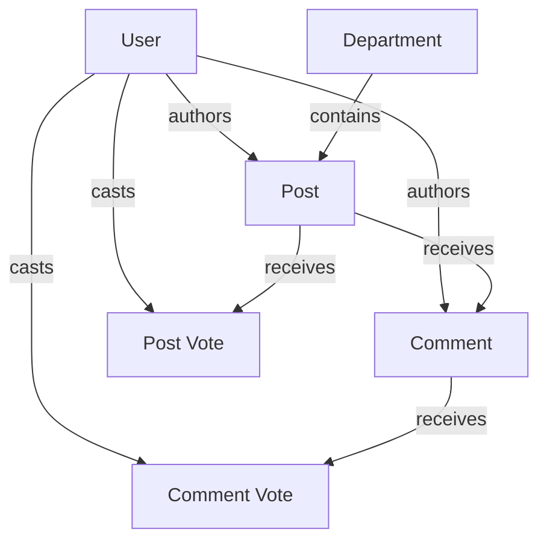

The principal relationships are:

- One **User** can author many posts.
- One **User** can author many comments.
- One **Department** can contain many posts.
- One **Post** can contain many comments.
- One **Post** can receive many post votes.
- One **Comment** can receive many comment votes.
- One **User** can vote on many posts and comments, but database constraints allow only one vote from that user on each individual post or comment.

Foreign-key relationships use Django's cascading deletion behaviour. Deleting a parent record therefore removes dependent records where the model relationship specifies `on_delete=models.CASCADE`.

### Department

The `Department` model groups posts into areas of discussion.

| Field | Type | Purpose |
| --- | --- | --- |
| `id` | Auto-generated primary key | Uniquely identifies the department. |
| `name` | `CharField(100)` | Department name. |
| `description` | `TextField` | Describes the department. |
| `created_at` | `DateTimeField` | Records when the department was created. |

A department can be linked to many posts.

### Post

The `Post` model represents the primary discussion content on Pulse.

| Field | Type | Purpose |
| --- | --- | --- |
| `id` | Auto-generated primary key | Uniquely identifies the post. |
| `author` | `ForeignKey(User)` | Identifies the user who created the post. |
| `department` | `ForeignKey(Department)` | Associates the post with a department. |
| `title` | `CharField(200)` | Stores the post title. Whitespace-only values are rejected. |
| `content` | `TextField` | Stores the post body. Whitespace-only values are rejected. |
| `created_at` | `DateTimeField` | Records when the post was created. |
| `updated_at` | `DateTimeField` | Records the latest model update. |
| `is_edited` | `BooleanField` | Records whether the post has been edited. |
| `image` | `ImageField` | Optional uploaded image stored under `post_images/`. |

Uploaded post images are restricted by file-extension and file-size validation.

The displayed post score is calculated from related `PostVote` records rather than stored as a separate database field.

### Comment

The `Comment` model stores replies attached to posts.

| Field | Type | Purpose |
| --- | --- | --- |
| `id` | Auto-generated primary key | Uniquely identifies the comment. |
| `post` | `ForeignKey(Post)` | Identifies the post that owns the comment. |
| `author` | `ForeignKey(User)` | Identifies the user who created the comment. |
| `content` | `TextField` | Stores the comment body. Whitespace-only values are rejected. |
| `created_at` | `DateTimeField` | Records when the comment was created. |
| `updated_at` | `DateTimeField` | Records the latest model update. |
| `is_edited` | `BooleanField` | Records whether the comment has been edited. |

The displayed comment score is calculated from related `CommentVote` records rather than stored as a separate database field.

### PostVote

The `PostVote` model records an authenticated user's vote on a post.

| Field | Type | Purpose |
| --- | --- | --- |
| `id` | Auto-generated primary key | Uniquely identifies the vote. |
| `post` | `ForeignKey(Post)` | Identifies the post being voted on. |
| `user` | `ForeignKey(User)` | Identifies the user casting the vote. |
| `value` | `SmallIntegerField` | Stores either `1` for an upvote or `-1` for a downvote. |
| `created_at` | `DateTimeField` | Records when the vote was created. |
| `updated_at` | `DateTimeField` | Records when the vote was last changed. |

Database constraints enforce that:

- `value` can only be `1` or `-1`.
- each user can have only one vote record for a particular post.

This allows an existing vote to be changed or removed without allowing duplicate votes from the same user.

### CommentVote

The `CommentVote` model provides the equivalent voting structure for comments.

| Field | Type | Purpose |
| --- | --- | --- |
| `id` | Auto-generated primary key | Uniquely identifies the vote. |
| `comment` | `ForeignKey(Comment)` | Identifies the comment being voted on. |
| `user` | `ForeignKey(User)` | Identifies the user casting the vote. |
| `value` | `SmallIntegerField` | Stores either `1` for an upvote or `-1` for a downvote. |
| `created_at` | `DateTimeField` | Records when the vote was created. |
| `updated_at` | `DateTimeField` | Records when the vote was last changed. |

Database constraints enforce that:

- `value` can only be `1` or `-1`.
- each user can have only one vote record for a particular comment.

### Django User Model

Pulse uses Django's built-in authentication `User` model.

The application does not maintain a separate custom profile database model. User relationships are established directly from posts, comments and vote records to Django's authenticated user records.

---

## Viewing the Site Locally

Clone Repository

```bash
git clone https://github.com/MSR-Projects7274/pulse.git
cd pulse
```

Create Virtual Environment

```bash
python -m venv venv
```

Activate Environment
Windows

```bash
venv\Scripts\activate
```

macOS / Linux

```bash
source venv/bin/activate
```

Install Dependencies

```bash
pip install -r requirements.txt
```

Configure Local Environment

Pulse reads its configuration directly from environment variables. The included `.env.example` documents the available variable names, but `.env` files are not loaded automatically by the application.

Before running Django commands, configure the required values in the current terminal session. For PowerShell:

```powershell
$env:SECRET_KEY="replace-with-a-local-development-secret"
$env:DEBUG="True"
```

`ALLOWED_HOSTS` and `CSRF_TRUSTED_ORIGINS` already provide localhost defaults. If `DATABASE_URL` is not set, Pulse uses the local SQLite fallback database.

When `DEBUG=True`, uploaded media is stored locally in the project's `media/` directory, so AWS credentials are not required for normal local development. In production, when `DEBUG=False`, uploaded media is stored using Amazon S3 and the documented AWS environment variables must be supplied.

Apply Migrations

```bash
python manage.py migrate
```

Create Superuser (Optional)

```bash
python manage.py createsuperuser
```

Run Server

```bash
python manage.py runserver
```

Open in your browser:

```
http://127.0.0.1:8000/
```

---

## Deployment

<details>
<summary><strong>Click to expand deployment information</strong></summary>

<br>

Pulse is deployed using Heroku.

**Live site:** [Pulse](https://pulse-forum-app-8e032ffcfcb8.herokuapp.com/)

The application uses the Heroku Python buildpack and runs on the **Heroku-24 stack**.

The production deployment has been tested directly on Heroku during the remediation process. Production verification and manual testing evidence are documented separately in `TESTING.md`.

### Heroku Application Processes

Pulse uses a root-level `Procfile` to define the processes required by Heroku.

```text
release: python manage.py migrate --noinput
web: gunicorn pulse.wsgi
```

The `release` process applies outstanding Django database migrations automatically when a new release is deployed.

The `web` process starts the application using Gunicorn and serves the Django WSGI application defined by `pulse.wsgi`.

### Production Dependencies

Production dependencies are installed from `requirements.txt` during the Heroku build.

These include the Django framework, Gunicorn production server, PostgreSQL database support, WhiteNoise static-file handling and the packages required for persistent external media storage.

### Production Database

Pulse uses PostgreSQL as its production relational database.

The live Heroku deployment was verified through Django's active database connection and reported PostgreSQL as both the database vendor and backend engine.

Production database configuration is supplied through the `DATABASE_URL` environment variable. When this variable is available, Django uses `dj-database-url` to parse the connection string and configure the default database connection.

```python
DATABASE_URL = os.environ.get('DATABASE_URL')

if DATABASE_URL:
    DATABASES = {
        'default': dj_database_url.parse(DATABASE_URL)
    }
```

The PostgreSQL connection string itself is treated as a secret and is not committed to the repository.

When `DATABASE_URL` is not present, Pulse falls back to a local SQLite database. This allows the application to be run locally without connecting development commands or test data to the live production database.

PostgreSQL support is provided through the project's `psycopg` dependencies.

### Production Media Storage

Pulse uses Amazon S3 for persistent uploaded media storage.

User-uploaded post images are stored through Django's storage system using `django-storages` and Boto3. The application's default storage backend is configured as `storages.backends.s3.S3Storage`, and the active storage backend has been verified directly on the live Heroku deployment.

Post images are uploaded through the `Post.image` field into the `post_images/` storage path.

Amazon S3 is used because files stored directly on Heroku's application filesystem are not suitable for persistent user uploads. Storing uploaded media externally allows images to remain available independently of dyno restarts and application rebuilds.

The S3 configuration uses Signature Version 4 and virtual-hosted addressing. Uploaded files are not overwritten automatically when another file uses the same name.

Media-storage credentials and bucket configuration are supplied through environment variables rather than being committed to the repository. The required environment-variable names are documented separately in the deployment configuration section.

### Environment Variables

Pulse uses environment variables for deployment-specific configuration and sensitive credentials.

Secret or environment-specific values are not committed to the repository. The repository includes `.env.example` to document the variable names required or supported by the application without exposing their real values.

| Variable | Purpose |
| --- | --- |
| `SECRET_KEY` | Django cryptographic secret used for security-sensitive application operations. |
| `DEBUG` | Controls Django debug mode. Production should run with debug mode disabled. |
| `ALLOWED_HOSTS` | Defines the hostnames Django is permitted to serve. |
| `CSRF_TRUSTED_ORIGINS` | Defines trusted origins for Django CSRF protection in the deployed application. |
| `DATABASE_URL` | Provides the production PostgreSQL connection string. When absent, Pulse falls back to local SQLite. |
| `AWS_ACCESS_KEY_ID` | AWS credential used by Boto3 to access the configured S3 storage. |
| `AWS_SECRET_ACCESS_KEY` | AWS secret credential used by Boto3 to access the configured S3 storage. |
| `AWS_STORAGE_BUCKET_NAME` | Identifies the Amazon S3 bucket used for uploaded media. |
| `AWS_S3_REGION_NAME` | Identifies the AWS region containing the configured S3 bucket. |

The real values for these variables must be configured separately in the local environment or through Heroku Config Vars. They must not be copied into the README, committed to Git, or included in screenshots or testing evidence.

### Python Runtime

Pulse includes a root-level `.python-version` file to define the Python runtime line used by the project.

```text
3.14
```

The `.python-version` file is tracked in the repository so that the required Python version is visible to both local development tooling and the deployment environment.

The local development environment was verified using Python **3.14.0**.

The live Heroku deployment was also verified directly and currently runs Python **3.14.8**. The project therefore targets the Python **3.14** runtime line rather than documenting a specific patch release as identical across all environments.

### Static File Handling

WhiteNoise is included directly after Django's security middleware and is used to serve collected production static files.

The project uses `CompressedManifestStaticFilesStorage`, allowing Django's collected static assets to be compressed and versioned for production use.

The source static assets remain in the project's `static` directory, while the generated `staticfiles` directory is created during deployment and is not treated as source code.

### Reproducing the Heroku Deployment

The following process can be used to reproduce the Pulse production deployment on Heroku.

#### 1. Prepare the Repository

Clone the repository and move into the project directory.

```bash
git clone https://github.com/MSR-Projects7274/pulse.git
cd pulse
```

Install the project dependencies from `requirements.txt`.

```bash
pip install -r requirements.txt
```

The repository contains a root-level `.python-version` file specifying the Python 3.14 runtime line.

#### 2. Log In to Heroku

Authenticate with the Heroku CLI.

```bash
heroku login
```

#### 3. Create or Select a Heroku Application

A new Heroku application can be created with:

```bash
heroku create <app-name>
```

If an application already exists, its name can be supplied to subsequent Heroku commands using the `--app` option.

#### 4. Configure the Heroku Stack and Buildpack

Pulse is deployed using the **Heroku-24** stack and the official Heroku Python buildpack.

```bash
heroku stack:set heroku-24 --app <app-name>
heroku buildpacks:set heroku/python --app <app-name>
```

#### 5. Configure Environment Variables

Configure the deployment environment using Heroku Config Vars.

The required or supported variable names are:

```text
SECRET_KEY
DEBUG
ALLOWED_HOSTS
CSRF_TRUSTED_ORIGINS
DATABASE_URL
AWS_ACCESS_KEY_ID
AWS_SECRET_ACCESS_KEY
AWS_STORAGE_BUCKET_NAME
AWS_S3_REGION_NAME
```

The real values must be supplied through Heroku or another secure environment configuration mechanism. They must not be committed to the repository.

`DATABASE_URL` must point to the production PostgreSQL database.

The AWS variables provide access to the Amazon S3 bucket used for persistent uploaded media.

Production should run with Django debug mode disabled.

#### 6. Deploy the Application

Ensure the Heroku Git remote is available, then deploy the application.

```bash
git push heroku main
```

For deployments made through another connected Git provider, deploy the required branch through that provider's Heroku integration instead.

#### 7. Database Migrations

Pulse defines a Heroku release process in the root-level `Procfile`:

```text
release: python manage.py migrate --noinput
```

This applies outstanding Django migrations as part of the Heroku release process before the new web release becomes active.

The web process is also defined in the `Procfile`:

```text
web: gunicorn pulse.wsgi
```

Gunicorn therefore starts the Django WSGI application when the deployed web dyno launches.

Migration state can also be inspected manually when required:

```bash
heroku run python manage.py showmigrations --app <app-name>
```

#### 8. Static File Collection

Pulse uses WhiteNoise and `CompressedManifestStaticFilesStorage` for production static files.

Source static assets are read from the project's `static` directory and collected into `staticfiles`.

Static collection has not been disabled through the `DISABLE_COLLECTSTATIC` Heroku configuration variable.

The production configuration has also been checked directly using:

```bash
heroku run python manage.py collectstatic --noinput --dry-run --app <app-name>
```

The live verification completed successfully and recognised the existing collected static assets.

#### 9. Verify the Deployment

After deployment:

1. Open the live application.
2. Confirm that the home page and static assets load correctly.
3. Confirm that authentication works.
4. Verify post and comment CRUD behaviour.
5. Verify that uploaded images are served from persistent S3 storage.
6. Confirm that production database data persists across a dyno restart.
7. Review Heroku logs for unexpected application errors.

Heroku logs can be viewed with:

```bash
heroku logs --tail --app <app-name>
```

Detailed production verification evidence is maintained in `TESTING.md`.

### Deployment Verification

Deployment testing is performed against the live Heroku application rather than relying only on the local development server.

The remediation testing includes production CRUD checks, authentication and permission behaviour, uploaded-media persistence, static assets, error handling and persistence following a Heroku dyno restart.

Detailed testing evidence is maintained in `TESTING.md`.

</details>

---

## User Features

- **Accounts**
  - Register a new account
  - Log in and log out securely
  - Session-based authentication
- **Posts**
  - Create posts
  - Optionally upload an image with a post
  - Edit and delete your own posts
  - View all posts in the main feed
  - View individual post detail pages
  - See edited-state and timestamp information
- **Comments**
  - Add comments to posts
  - Edit and delete your own comments
  - View comments within post discussions
  - See edited-state and timestamp information
- **Voting**
  - Upvote and downvote posts
  - Upvote and downvote comments
  - Change or remove an existing vote
- **Discovery**
  - Search posts by title and content
  - Browse posts by department
  - View posts ordered by newest first
- **Profiles**
  - View your own profile and contributions
  - View other users' public profiles and posts
- **Responsive Interface**
  - Use the application across desktop, tablet and mobile layouts
  - Navigate through a consistent shared interface
- **Permissions and Feedback**
  - Restrict editing and deletion to content owners
  - Require authentication for protected actions
  - Provide user-facing feedback for important actions and validation

---

## User Stories

### New User / Visitor

- As a visitor, I want to register an account so that I can participate in discussions.
- As a visitor, I want to understand what the platform is about so that I know its purpose before signing up.

---

### Authenticated User

- As a user, I want to log in so that I can access my account and interact with content.
- As a user, I want to log out so that I can securely end my session.

---

### Content Creator

- As a user, I want to create a post so that I can share my thoughts with others.
- As a user, I want to optionally add an image to a post so that I can support my written content visually.
- As a user, I want to edit my posts so that I can correct or update my content.
- As a user, I want to delete my posts so that I can remove content I no longer want visible.

---

### Reader / Community Member

- As a user, I want to view a list of posts so that I can browse discussions.
- As a user, I want to view a single post so that I can read full discussions in context.
- As a user, I want to comment on posts so that I can engage with the community.
- As a user, I want to view comments so that I can follow ongoing conversations.
- As a user, I want to edit my comments so that I can correct or update my responses.
- As a user, I want to delete my comments so that I can remove content I no longer want displayed.

---

### Explorer / Discovery User

- As a user, I want to search posts so that I can find specific discussions quickly.
- As a user, I want to browse posts by department so that I can focus on relevant topics.
- As a user, I want posts ordered by newest first so that I can see the latest activity.
- As a user, I want to browse content easily so that I can discover interesting discussions.

---

### Profile-Focused User

- As a user, I want to view my profile so that I can see my activity and contributions.
- As a user, I want to view other users' profiles so that I can explore their posts.

---

### Mobile / Multi-Device User

- As a user, I want the interface to be responsive so that I can use the platform on any device.
- As a user, I want navigation to be consistent so that I can move around the site easily.

---

### Engagement-Oriented User

- As a user, I want to upvote or downvote posts so that I can express my reaction to content.
- As a user, I want to upvote or downvote comments so that I can react to individual contributions.
- As a user, I want to change or remove my vote so that I remain in control of my reaction.

---

## User Story Mapping

| User Story | Implementation |
|------------|---------------|
| User registration | Django `UserCreationForm` with custom registration template |
| Login/logout system | Django authentication with custom login/logout views |
| Create post | `Post` model, `PostForm` and `create_post` view |
| Upload post image | Optional `Post.image` field with validated media handling |
| Edit post | `edit_post` view with author permissions |
| Delete post | `delete_post` view with owner restriction and confirmation |
| Post feed | `home` view ordered by newest first |
| Single post view | `post_detail` view with comments and voting |
| Create comments | `Comment` model and post-detail comment form |
| Edit comments | Owner-restricted `edit_comment` view |
| Delete comments | Owner-restricted `delete_comment` view |
| Search posts | Query-based filtering of post title and content |
| Browse departments | Department filtering through department-specific post views |
| Profile pages | User-based post filtering on public profile pages |
| Post voting | `PostVote` model and authenticated voting views |
| Comment voting | `CommentVote` model and authenticated voting views |
| Responsive UI | CSS media queries and flexible layouts |
| Navigation system | Shared base-template navigation |
| Content ownership | Permission checks restrict post/comment changes to their authors |

---

## User Story Validation (Screenshots)

The following screenshots provide visual evidence that the key user stories identified for this project have been implemented successfully. The system is designed to support structured discussion, easy navigation, and clear user interaction flows.

<details>
<summary>Click to expand user story validation</summary>

---

### New User / Visitor

**User Need:**  
As a visitor, I want to register an account and understand the platform so that I can decide to join the community.

**Evidence:**  
- Registration form enforces username and password validation rules.  
- Clean landing page introduces platform purpose and navigation options.

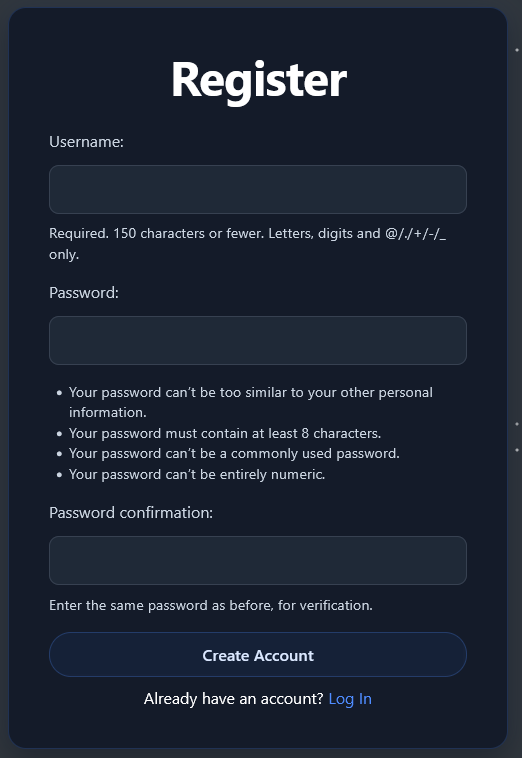
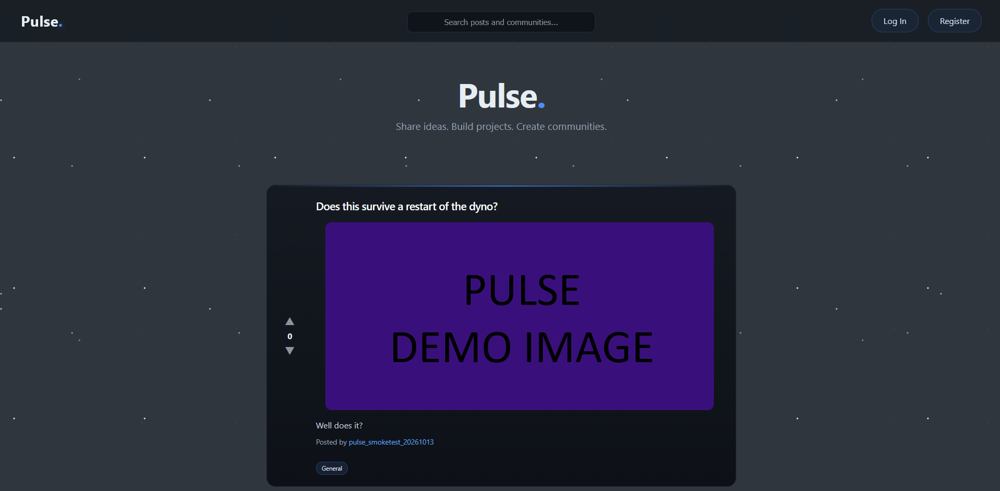

---

### Authenticated User

**User Need:**  
As a user, I want to log in and log out so that I can securely manage my account access.

**Evidence:**  
- Login system validates credentials and redirects users appropriately.  
- Logout clears session securely.

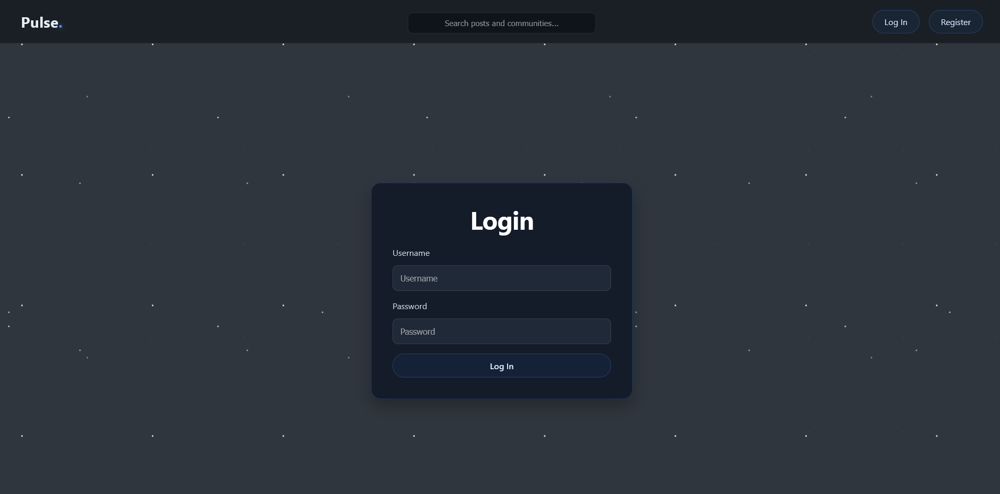

---

### Content Creator

**User Need:**  
As a user, I want to create, edit, and delete posts so that I can manage my content freely.

**Evidence:**  
- Post creation form allows structured input for title and content.  
- Edit and delete options are restricted to the post author only.

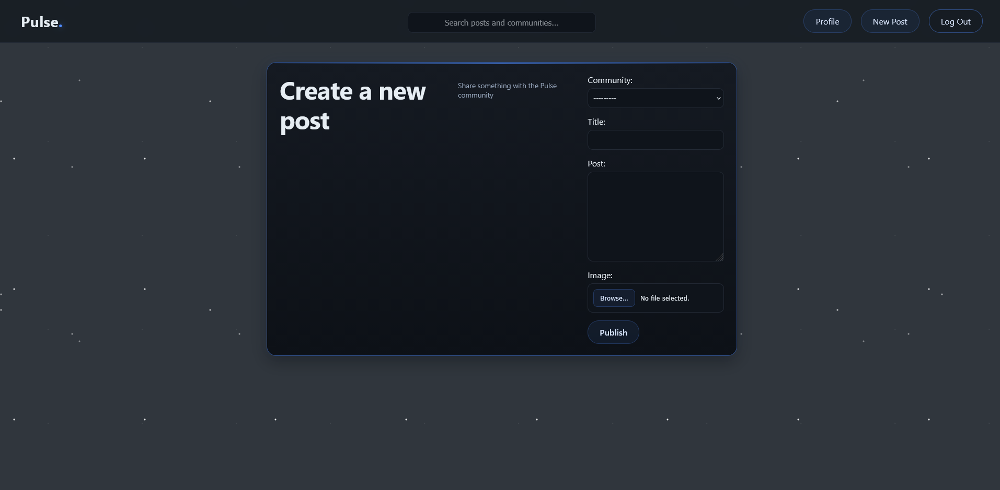
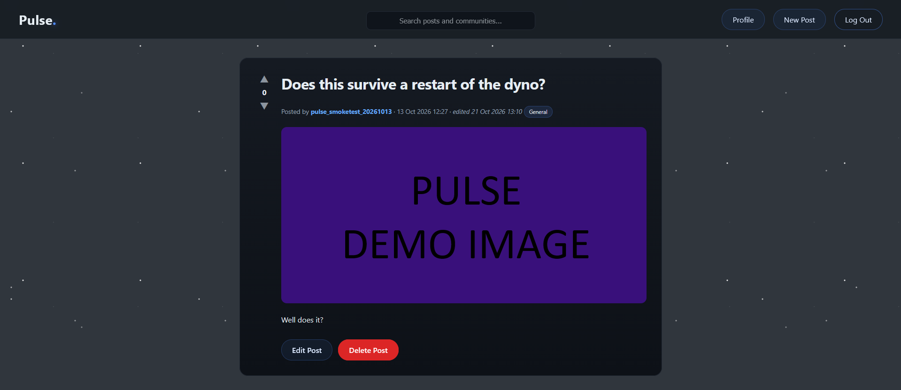

---

### Reader / Community Member

**User Need:**  
As a user, I want to browse posts and engage with comments so that I can participate in discussions.

**Evidence:**  
- Posts are displayed in reverse chronological order.  
- Comment system is visible under each post with timestamps and user attribution.

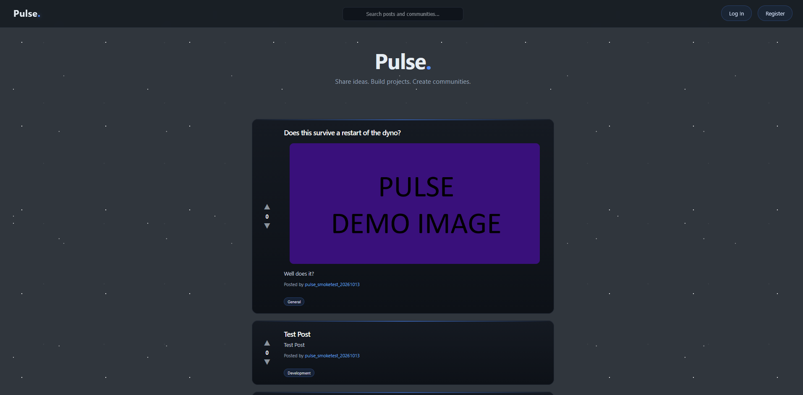
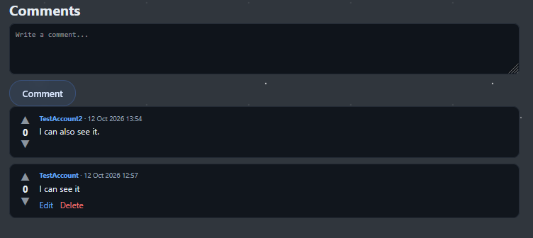

---

### Explorer / Discovery User

**User Need:**  
As a user, I want to search and filter posts so that I can find relevant discussions quickly.

**Evidence:**  
- Search functionality filters posts by keywords in title and content.  
- Empty state messaging is displayed when no results are found.

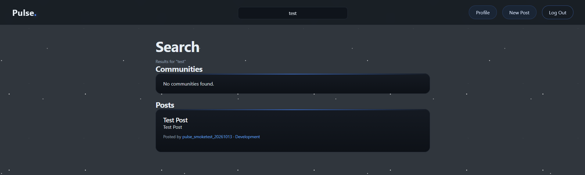

---

### Profile-Focused User

**User Need:**  
As a user, I want to view profiles so that I can explore user activity and contributions.

**Evidence:**  
- Profile pages display user posts and basic account information.  
- Users can view other public profiles without accessing private data.

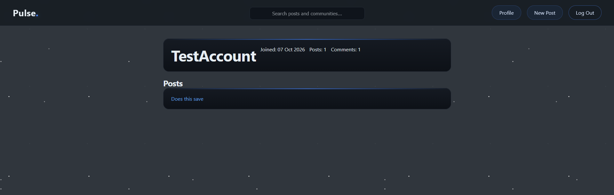

---

### Mobile / Multi-Device User

**User Need:**  
As a user, I want a responsive interface so that I can use the platform on any device.

**Evidence:**  
- Layout adapts dynamically to screen size.  
- Navigation remains usable across desktop and mobile views.

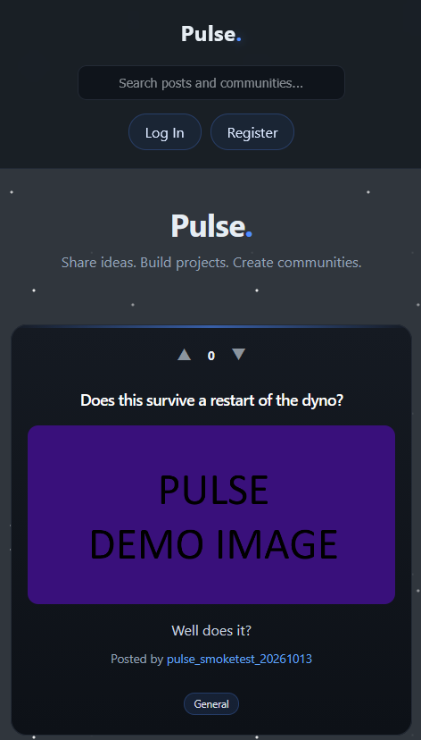

</details>

---

## Wireframes

The initial wireframes established the core layout and navigation structure for Pulse before the interface was implemented.

The design was guided by several UX priorities:

- **Clear visual hierarchy** – branding, navigation, discussion content and primary actions are separated so users can quickly understand where they are and what actions are available.
- **Consistent navigation** – the shared navigation pattern gives users predictable access to the main areas of the application and supports the user story requiring consistent navigation across the site.
- **Focused content presentation** – discussion content remains the visual priority, while supporting controls such as voting, editing and profile access are kept secondary to the post or conversation itself.
- **Controlled spacing and readable layouts** – spacing between interface elements is used to prevent dense discussion content, forms and controls from becoming visually cluttered.
- **Responsive behaviour** – the interface adapts through CSS media queries and flexbox so navigation, forms and discussion content remain usable across desktop, tablet and mobile layouts.
- **User control and feedback** – authenticated users retain control over their own posts and comments, destructive actions use confirmation steps, and form validation or system feedback is presented clearly when an action cannot be completed.
- **Accessibility and consistency** – shared templates and reusable styling help maintain consistent controls, navigation and page structure across the application.

The wireframes were treated as an initial design guide rather than a rigid specification. During implementation and testing, the interface was refined where necessary to improve responsive behaviour, navigation consistency, form usability and clarity. These changes preserve the original goal of a simple discussion-focused interface while adapting the design to the behaviour of the completed application.

[View desktop wireframes](pulse/wireframes/desktop_designs.png)

[View mobile wireframes](pulse/wireframes/mobile_designs.png)

---

## Testing

Pulse uses a combination of manual, production, automated, validation, responsive and security-focused testing to verify the application.

Detailed testing evidence is maintained separately in [`TESTING.md`](TESTING.md) so that the README can describe the project clearly without becoming dominated by individual test cases and validation records.

The testing documentation is organised to cover:

- production smoke testing against the live Heroku deployment;
- manual functional testing of the application's main user flows;
- automated Django test coverage;
- HTML, CSS and Python validation;
- responsive and browser testing;
- production CRUD verification;
- authentication and permission testing;
- custom error-page testing;
- bugs found and fixed during development and remediation;
- any known bugs remaining after final testing.

The existing production testing record already includes live verification of registration, authentication, post and comment CRUD, voting, profile access, permission handling, custom 404 behaviour, static assets and persistence following a Heroku dyno restart.

User-story validation is documented separately in its own section. Its screenshots demonstrate that the planned functionality was implemented, while `TESTING.md` records whether that functionality behaves correctly under specific test conditions.

For the complete testing record, see **[TESTING.md](TESTING.md)**.

---

## Assessment Remediation

The original assessment identified several areas where the submitted Pulse application did not meet the required criteria. The table below maps those findings to the remediation work completed since the assessed submission.

Where several criteria referred to the same underlying problem, they are grouped together to avoid duplicating the same repair evidence.

| Assessment Criterion | Assessment Issue | Remediation | Commit Evidence | Verification / Test Evidence |
| --- | --- | --- | --- | --- |
| LO1 1.3; LO3 3.1; Merit feedback 1.2, 3.1 and 3.2 | Core production CRUD behaviour was unreliable. Fresh users encountered server errors, post-detail behaviour could fail, and image creation/editing did not function correctly. | Corrected the malformed post-detail template condition, added the image field to `PostForm`, rendered post images correctly, configured persistent S3 media storage, strengthened form validation, restricted state-changing actions to POST requests, corrected permission handling and added user-facing success/error feedback. | `ef4346f`, `2d1e09a`, `a18f917`, `58f8bc3`, `41937ce`, `74643d7`, `8995f60`, `edf6704`, `d77224a`, `0ec6d90`, `c91ca33`, `9033434` | Automated tests cover fresh-user access, post and comment CRUD, image creation/replacement, permissions and voting. Production CRUD testing is recorded in `TESTING.md`, including persisted database and media behaviour. |
| LO1 1.5; Merit feedback 1.5 and 1.6 | Testing evidence was insufficient to demonstrate that functionality, validation and production behaviour had been tested comprehensively. Bugs remained undocumented or were only represented through screenshots. | Added a comprehensive automated Django test suite, a production smoke-test checklist, recorded manual production testing, HTML/CSS/Python validation, responsive/browser testing, production CRUD testing, authentication/permission testing, custom error-page testing and documented bug investigation and fixes. | Automated test commits `3c293b3` through `2b28a68`; `0056b35`, `6956ba2`, `2887a0c`, `b56800e`, `fb15673`, `41bcb96`, `bad9246`, `2cb6784`, `5afc6bc`, `18a99c4`, `53978bc` | The Django suite currently contains 37 passing tests. `TESTING.md` records automated results, rendered HTML validation, CSS validation, Python linting, responsive/browser checks, production CRUD checks, authentication/permission checks and custom 403/404/500 verification. |
| LO4 4.1 | The live Heroku deployment did not reproduce the working behaviour shown in the submitted local testing evidence, creating a production-parity and deployment-reliability problem. | Reworked production configuration around PostgreSQL, persistent Amazon S3 media storage, automatic release-phase migrations, generated static files, the root Python runtime file, current dependencies, environment-controlled settings, HTTPS/proxy configuration and production logging. | Media: `58f8bc3` through `876787c`; database: `e703288` through `bb50845`; migrations: `d8e16b4`; deployment/runtime: `63924af`, `3ef544c`, `f415537`, `a814e70`, `bb8a8c8`, `5c40326`, `c4378b7`, `f441e00`, `ec08859` | Production PostgreSQL and the active S3 storage backend were verified directly. Database records and uploaded media survived a Heroku dyno restart, production migrations were applied and production static-file collection completed successfully. |
| LO4 4.2 | Invalid or unauthorised routes were not handled cleanly in production and could expose unhandled error responses instead of preserving the application experience. | Added explicit permission handling together with branded custom 403, 404 and 500 responses. | `d77224a`, `3804a40`, `0173a46`, `fbe81b2`, `4e5a9b9`, `2b28a68`, `18a99c4` | Non-owner edit attempts return 403, invalid resources return the custom 404 response, and the custom 500 handler was verified under `DEBUG=False`. Automated tests cover 403 and 404 behaviour and the production checks are recorded in `TESTING.md`. |
| LO5 5.1; Merit feedback 4.1 | The original repository history contained large/general commits and did not provide a sufficiently granular SDLC audit trail. | The historical development record has not been rewritten or falsified. Instead, remediation work has been carried out incrementally using small, specifically named commits so the repair process itself remains auditable. | Remediation history from `46a466a` onward. | The Git history itself provides the evidence. Security, CRUD, testing, deployment, accessibility, documentation and validation repairs are recorded as separate logical commits rather than being collapsed into a single repair commit. |
| LO5 5.2 and 5.3 | The submitted repository contained a hardcoded Django `SECRET_KEY` and did not adequately exclude secret/environment files from source control. | Removed the production secret from source, changed Django to read `SECRET_KEY` from the environment, rotated the exposed production key, added repository-level secret exclusions and an `.env.example`, and documented required environment-variable names without their real values. | `46a466a`, `5a22655` | Current configuration obtains sensitive values from the environment rather than a literal production secret. `.env.example` documents configuration names using non-secret placeholders and the deployment documentation lists required variables without exposing their values. |

### Assessment Clarification

The later assessment clarification confirmed that Cloudinary was not a project requirement and that its mention in the original feedback was an administrative error by the assessor. Pulse therefore does not claim a Cloudinary remediation. The current application uses Amazon S3 as its verified persistent media-storage backend.

The clarification also confirmed that the deployment finding was not evidence that a different Git commit had been deployed. The remediation work therefore addresses the actual issue identified: the live production application did not reproduce the reliable behaviour demonstrated by the local testing evidence.

This table documents the work carried out in response to the assessment findings. It does not rewrite the historical development record or treat the remediation process itself as a reassessment result.

---

## Security

Pulse applies security controls across authentication, permissions, data validation, configuration and production deployment.

### Authentication and Access Control

- User registration, login and logout are handled through Django's authentication system.
- Routes and actions that require authentication are protected so anonymous users cannot perform authenticated operations.
- Authenticated users can edit or delete only content that they own. Attempts to modify another user's content are rejected with Pulse's custom `403 Forbidden` response.
- State-changing actions use POST requests rather than GET requests where appropriate, reducing the risk of actions being triggered unintentionally.
- Login return destinations are validated before redirecting so an unsafe external `next` URL cannot be used as an open redirect.

### CSRF Protection

Django's CSRF protection is enabled throughout the application. Forms that submit data include CSRF tokens so requests are validated before state-changing operations are processed.

### Secrets and Environment Configuration

Sensitive production configuration is not stored directly in the current source code. Values such as the Django secret key, production database connection and Amazon S3 credentials are supplied through environment variables.

An `.env.example` file documents the required configuration names using non-secret placeholder values, while environment files and other local secret files are excluded through `.gitignore`.

The production `SECRET_KEY` that had originally been exposed during earlier development was removed from the source and rotated as part of the assessment remediation work.

### Production Security

Production runs with Django `DEBUG` mode disabled.

Production configuration also includes HTTPS/proxy-aware security settings so Django correctly recognises secure requests when deployed behind Heroku's proxy infrastructure.

The application uses PostgreSQL for production data and Amazon S3 for persistent uploaded media. S3 media is served using private signed URLs rather than exposing the bucket as unrestricted public storage.

### Input and Upload Validation

Pulse validates data at both form and model level.

- Required form fields are validated before records are saved.
- Post titles, post content and comments reject whitespace-only values.
- Uploaded post images are restricted to supported image formats.
- Uploaded images are subject to a file-size limit.
- Voting values are protected by database constraints as well as application logic.
- Django's built-in authentication forms provide validation for usernames and passwords.

Uploaded-image lifecycle handling also removes replaced, cleared and deleted post images from storage so obsolete media is not left behind by normal application operations.

### Error Handling

Pulse uses custom `403`, `404` and `500` responses so permission failures, missing resources and unexpected server errors fail cleanly without exposing debug information to users.

Validation errors are returned through the relevant forms, while successful data-changing operations use application feedback and redirects to make the result of the action clear to the user.

---

## Development Challenges

<details>
<summary>Click to expand development challenges</summary>

| Challenge | Issue | Resolution |
|-----------|-------|------------|
| Multi-app URL routing conflicts | Overlapping `urls.py` patterns between apps caused incorrect route matching and occasional 404 errors | Separated URL configurations per app using `include()` and kept route names distinct across the project |
| URL naming and reverse lookup issues | `reverse()` and `` required consistent route names across multiple app URL configurations | Standardised route names and refactored reverse lookups across the app URL configurations |
| Shell / model import issues | Django shell could not reliably import models due to incorrect import paths or early app loading issues | Fixed import paths, ensured proper app registration, and used fully qualified model references where needed |
| App registration and load order problems | Certain apps/models were unavailable during migrations or shell sessions due to incorrect `INSTALLED_APPS` ordering | Reordered `INSTALLED_APPS` and validated inter-app dependencies before migration |
| Migration dependency conflicts | Cross-app foreign keys caused migrations to fail or apply in incorrect order | Rebuilt migration chain where necessary and explicitly defined migration `dependencies` |
| Template resolution errors across apps | Django failed to consistently locate templates due to inconsistent folder structure | Standardised template structure using `templates/<app_name>/` and ensured `APP_DIRS = True` |
| Authentication flow inconsistencies | Login/logout sessions behaved unpredictably across different views and redirects | Unified authentication flow, standardised middleware usage, and fixed redirect handling logic |

</details>

---

## Lessons Learned

- Django project structure depends heavily on correct app configuration
- URL routing requires consistent route naming and careful reverse lookup management
- Model changes must be migrated carefully to avoid state mismatches
- Django shell is essential for backend debugging
- Authentication flows must be tested end-to-end early
- Rendered HTML must be validated and corrected even when markup is generated by Django forms

---

## Future Improvements

Potential future improvements include:

- User profiles with avatars
- Notification system
- Rich text editor for posts
- Moderation tools

---

## Credits

- **Favicons:** [Favicon.io](https://favicon.io/)
- **Bug fixes and advice:** ChatGPT provided guidance, code extracts and troubleshooting support
- **Favicon Design:** [Perchance.org](https://perchance.org/ai-text-to-image-generator)
